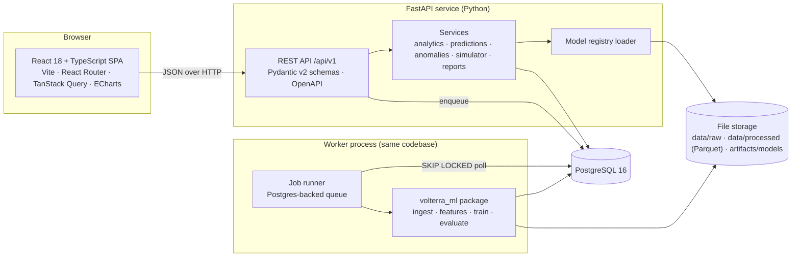
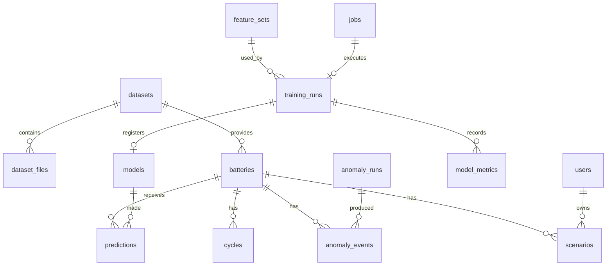

# VOLTERRA AI — Technical Assessment & Full-Stack Architecture Plan

| | |
|---|---|
| **Status** | Draft for review. No code changes made. |
| **Date** | 2026-11-12 |
| **Repository** | `https://github.com/amankhan1310/volterra-ai` (remote `origin`) |
| **Branch** | `main`, in sync with `origin/main` |
| **History** | 1 commit: `fcd084c first commit` (4 files, 2,125 lines) |
| **Untracked** | `.gitignore`, `CLAUDE.md`, `PROJECT_STATUS.md` (all three are empty, 0 bytes) |
| **Local toolchain found** | Node 18.20.8, Python 3.10.11, Windows 11 |

---

## 0. Executive summary

The repository has a **well-designed, honest, static browser prototype** of a battery health analytics app. It runs all of its analytics client-side over a **seeded synthetic dataset of 320 cycles from a 2.0 Ah cell**, and it consistently labels its outputs as *Simulated*, *Fitted* or *Predicted*. There is no backend, no persistence, no real data and no machine learning. The "predictions" come from an ordinary least-squares line, and the simulator uses hand-picked coefficients.

The target is a **React + TypeScript SPA**, a **FastAPI service**, **PostgreSQL**, and a **separate Python ML package** that trains, evaluates and versions real models on public battery-degradation datasets (NASA PCoE, CALCE, Severson/MIT-Stanford-Toyota).

The migration strategy is **parity first, then capability**:
1. Port the existing calculations to Python exactly. Golden tests generated from the current JavaScript will prove the outputs match.
2. Rebuild the UI in React with the same design and the same provenance labels.
3. Swap in real data and ML models behind the same API contracts.

Running the prototype headlessly also turned up several **correctness and honesty issues** (§3.6). They should be fixed during the port, not copied into the new system.

---

## 1. Existing functionality

### 1.1 Files and how they load

| File | Lines | Role |
|---|---|---|
| `index.html` | 85 | App shell: sidebar (`#side`, `#brand`, `#nav`, status card), header (burger, collapse, breadcrumb `#pt`, quick-nav `<select id="qn">`, "Simulated · 2.0 Ah" tag, notification bell `#bn`), `<main id="main">`. Loads Google Font *Manrope* and **ECharts 5.5.1 from jsDelivr**, then `core.js`, then `ui.js`. |
| `core.js` | 486 | **Data + analytics + original v1 UI.** Seeded PRNG, synthetic dataset, OLS fit, RUL, backtest, MAD anomaly detection, semi-empirical simulator, hand-rolled SVG chart helper, v1 page renderers, hash router. |
| `ui.js` | 671 | **Redesign layer ("Obsidian Intelligence").** Overrides `head`, `go`, `toast`, `simDraw`, and every `pages.*` renderer. Adds ECharts charts with SVG fallback, an isometric "3D" pack, and a grouped nav with icons. Reuses `core.js` calculations unchanged. |
| `style.css` | 883 | Lines 1–322 are the v1 theme (dark + light tokens). Lines 323–883 are redesign overrides: new dark tokens, glass cards, 12-column grid, segmented controls, range sliders, toast, responsive breakpoints at 1180/980/860/760 px. |

**Architecture pattern:** global-scope scripts that render HTML strings into `innerHTML`, with monkey-patching between files. `ui.js` redeclares `function go` and `function toast`, reassigns `head`, and later wraps `go` again (`const _go = go; go = function…`) to draw the anomaly charts. State lives in module-level globals (`P`, `saved`, `cur`). Routing uses `location.hash`.

### 1.2 Feature inventory (6 pages)

| Page (hash) | Nav group | What it does |
|---|---|---|
| **Overview** (`#overview`) | Monitor | SOH ring gauge with 60 tick marks and an inner "life used to EOL" ring. Condition label, RUL with a 95% fit interval, fade rate, backtest MAE. Six KPI cards (capacity and temperature with sparklines; voltage, cycles, fade, anomaly count). Degradation timeline (observed + linear forecast + EOL line, zoom slider, Full / Last-120 toggle). Four rule-based "Intelligence insights". Telemetry explorer (SOH / temp / voltage / capacity, with flagged points). |
| **Digital Twin** (`#digital`) | Monitor | Isometric 24-module pack in SVG. A cycle slider (0–319) and a Health/Temperature colour mode. Clicking a module lifts it. A side panel shows pack SOH, capacity, temperature and voltage at the chosen cycle, plus a mini SOH chart with a cursor. All modules share the **pack value**, and the page says so. |
| **What-If Simulator** (`#sim`) | Plan | Six sliders: T 5–45 °C, C-rate 0.5–3, DoD 20–100%, cycles 100–1500, initial SOH 70–100, EOL 60–90. Shows the SOH trajectory against the 25 °C / 1C / 80% DoD baseline, cycles to EOL, Δ vs baseline, and fade rate. Up to 4 saved scenarios (rename via `prompt()`, duplicate, delete) overlaid on the chart. In-memory only. |
| **Anomaly Detection** (`#anom`) | Monitor | Event count by severity, a three-lane SVG timeline (temp / volt / capacity), ECharts temperature and voltage plots with flagged points, and an event table (cycle, type, value, expected range, severity). |
| **Charging Advisor** (`#advisor`) | Plan | Baseline cycles to EOL, plus six one-factor sensitivity rows (15 °C, 35 °C, 0.5C, 2C, 60% DoD, 100% DoD) with a diverging bar and a percentage change. |
| **About** (`#about`) | Project | Data, method and limitations. Definitions of SOC, SOH and RUL. An explicit "Not included" list: CSV upload, Python backend, ML model comparison, PDF export, 3D twin. |

Cross-cutting features:
- A **"Run analysis"** button re-renders the page and shows a toast. Nothing is actually recomputed because the data is static.
- A notification bell shows the anomaly count.
- A collapsible sidebar and a mobile drawer.
- Tooltips via the `title` attribute.
- `prefers-reduced-motion` support.

---

## 2. Existing UI and design structure

### 2.1 Design system (to be preserved)

**Effective tokens.** The redesign block in `style.css:324-338` overrides the earlier ones.

| Token | Value | Use |
|---|---|---|
| `--bg` | `#070a0f` | page background, with two radial cyan/indigo glows |
| `--side` | `#0a0e15` | sidebar |
| `--card` / `--el` / `--hi` | `#0d121b` / `#121a26` / `#182333` | surface elevation steps |
| `--cy` | `#54e7ff` | primary accent / forecast |
| `--ib` | `#8dafff` | secondary accent (indigo-blue) |
| `--gr` | `#7cf2bc` | healthy / observed / fitted |
| `--am` | `#ffc56e` | caution / simulated |
| `--rd` | `#ff7185` | critical / EOL / anomaly |
| `--tx` / `--mu` / `--bd` | `#f5f7fc` / `#8998ad` / `#1b2638` | text / muted / border |

- **Typography:** Manrope 400–800, 14px base. H1 is 30px with a gradient text fill. Labels (`.lb`) are 11px uppercase with 0.09em tracking. Big numbers (`.big`, `.xl` 46px) use tabular numerals.
- **Components:** `.card` (glass gradient, 16px radius, inset highlight); `.card.hv` (hover lift); `.btn` (cyan→indigo gradient); `.btn.o` (outline); `.seg` (segmented control); `.tag.s/.f/.p` (provenance pills: amber *Simulated*, green *Fitted*, cyan *Predicted*); `.note` (amber left-border disclaimer); `.toast`; `.bar` (diverging bar); `.stats` / `.stats2` (stat grids); `.k12` with `.s3/.s4/.s6/.s8` (12-column grid); `.hg` (hero split); `.tw` (twin layout); `.sg` (three-column simulator workspace).
- **Health colour rule** (`hcol`): ≥85% green, ≥80% amber, otherwise red. **Condition labels** (`cond`): ≥90 Healthy, ≥85 Good, ≥80 Approaching EOL threshold, otherwise Below threshold.
- **Charts:** ECharts with a shared base option builder (`eb`): dark tooltip, top-right legend, optional inside+slider zoom, gradient area fills. The SVG `chart()` helper is the fallback when the CDN fails.
- **Responsive:** 12-column grid collapses at 980px; simulator goes to one column at 1180px; sidebar becomes an off-canvas drawer at 860px.

### 2.2 UI issues to fix in the React rebuild

1. **The light theme is broken in practice.** `index.html` hard-codes `data-theme="dark"`. The redesign overrides only the dark tokens. ECharts options and the SOH gauge use **hard-coded hex colours** (`#121A26`, `#8998AD`, etc.), so a light palette would never reach the charts.
2. **XSS surface:** every view uses `innerHTML` string templates. A scenario name typed into `prompt()` is interpolated unescaped (`ui.js:553`). This is harmless in a single-user static page but becomes a real vulnerability once names are stored server-side and shared. React's escaping fixes it by default.
3. Native `prompt()` / `alert()` (`core.js:440,451`) block the page. Replace them with in-page dialogs.
4. Tooltips use `title=`, which keyboard and touch users can't reach. Twin modules handle Enter but not Space. Charts have no data-table alternative.
5. Dead and duplicate code: the whole v1 renderer set in `core.js` is overridden by `ui.js`; there is a no-op `setTimeout(() => 0)` at `ui.js:593`; and an unused regression `r = lin(t, col("soh"))` at `core.js:279`.

---

## 3. Existing analytical calculations

### 3.1 Synthetic data generator (`core.js:6-32`)

- **PRNG:** `mulberry32` seeded with `7`. Noise is `gn() = (R()+R()+R() − 1.5) × 1.15`, an approximately normal Irwin–Hall sum of three uniforms.
- **N = 320 cycles, NOM = 2.0 Ah**, which matches the NASA PCoE 18650 cells.
- Per cycle *i*:
  - `cap = 2.0 × (1 − 0.00028·i − 5e-7·i²) + 0.004·gn()`: quadratic, accelerating fade.
  - `soh = cap / 2.0 × 100`
  - `temp = 24 + 3·sin(i/22) + 0.6·gn() + 9·[i ∈ {90,170,251}]`: **3 injected temperature spikes**.
  - `volt = 3.72 − 0.0002·i + 0.01·gn() − 0.18·[i ∈ {130,271}]`: **2 injected voltage dips**.

### 3.2 SOH, trend and RUL

- `lin(xs, ys)` is OLS returning slope `s`, intercept `b`, residual SD `sd`, and slope standard error `se = sd/√Sxx`.
- The fit window is the **last 120 cycles** (200–319). Results:
  - `sohNow = b + s·319` (the *fitted* SOH at the last cycle, not the observed one).
  - `fade = −s` (%/cycle).
- `rulAt(E, s) = (sohNow − E)/(−s)`, the linear extrapolation to the EOL threshold (default 80%).
- The **"95% fit interval"** recomputes RUL with slopes `s ± 1.96·se`.
- **Backtest:** fit on cycles 100–219, predict 220–319, report MAE.
- **Insights:** the first-half slope (cycles 0–159) is compared with the last-120 slope; there is also an anomaly count.

**Values computed from the current code** (by running `core.js` in Node):

| Metric | Value |
|---|---|
| SOH at cycle 0 → now | 99.90% → **86.09%** |
| Fade (last 120) | 0.0540 %/cycle |
| Slope SE | 0.000314 |
| RUL to 80% | **113 cycles** (fit interval **111–114**) |
| Backtest MAE | **0.58 SOH points** |
| Simulator baseline cycles to 80% | **106 cycles** |

### 3.3 Anomaly detection (`core.js:74-103`)

- Robust z-score per channel: `z = 0.6745·(v − median)/MAD`. Flagged if `|z| > 3.5`. Severity is **high** if `|z| > 6`, otherwise medium. The "expected range" is `median ± 3.5·MAD/0.6745`.
- Channels: **temperature** (raw), **voltage** (raw), and **capacity step**, which is the SOH residual against a centred 15-cycle rolling median.

### 3.4 Semi-empirical simulator (`core.js:105-116`)

```
r(T, C, D)  = fade × e^{0.06(T−25)} × (1 + 0.4(C−1)) × (D/80)^0.9
SOH(n)      = SOH₀ − r·n·(1 + n/1500)
eolN(p)     = first n ∈ [0, 5000] with SOH(n) ≤ E   (linear scan)
```
The baseline is T=25, C=1, D=80. The coefficients 0.06, 0.4, 0.9 and 1500 are **assumed**, and the UI says so. The Charging Advisor runs one-factor-at-a-time sensitivity on this model.

### 3.5 Digital twin

There is no model. It colours 24 identical modules from the pack value. Temperature bands are <30 / 30–40 / >40 °C. The synthetic data never exceeds about 37 °C, so red never appears.

### 3.6 Correctness findings (verified by running the code)

These are **important for the migration**. They should become tested, deliberate behaviour changes, not silent copies.

| # | Finding | Evidence | Fix in new system |
|---|---|---|---|
| F1 | **Temperature detector misses 2 of 3 injected spikes.** It flags cycle 170 only, and misses 90 and 251. The global median/MAD is inflated by the ±3 °C sinusoid, so +9 °C spikes on the low part of the wave fall under the threshold. | Flagged temp events: `[170]` | Detrend first (rolling-median or STL residual), then apply robust z. Evaluate recall on labelled injections. |
| F2 | **All 5 capacity-step flags are false positives.** The generator injects no capacity steps, yet cycles 125, 127, 254, 315 and 319 are flagged. 315 and 319 are edge effects of the truncated centred window. | Flagged soh events with \|z\| 3.5–3.9 | Edge-aware windows, a minimum effect size (e.g. ≥0.3 SOH pts), and precision/recall tests. |
| F3 | **The RUL "95% interval" is far too narrow** (111–114 cycles). It reflects only slope SE and ignores intercept SE, residual noise, and model-form error (fade is quadratic, not linear). The backtest MAE of 0.58 SOH pts ≈ **±11 cycles** at the current fade rate, which is roughly 4× the stated interval width. | `se = 3.1e-4` | Prediction intervals from quantile models or conformal calibration, validated by empirical coverage. |
| F4 | **Two pages give different lifetimes for the same conditions.** Overview says 113 cycles to 80%. The simulator baseline (identical 25 °C/1C/80%) says **106**, because it adds the `(1 + n/1500)` acceleration term and starts from a rounded SOH. | `rulAt(80)=112.7`, `eolN(base)=106` | One prediction service as the single source of truth, with simulator scenarios expressed relative to it. |
| F5 | **Insight #2 always says "Fade is accelerating"**, whatever the numbers (`core.js:284`). The Overview hero applies a `> 1.2×` check, but the insights panel does not. | hard-coded string | Generate insights from rules with explicit conditions, with unit tests per rule. |
| F6 | The linear model is structurally biased on data that is quadratic by construction. Any forecast beyond a few dozen cycles will be optimistic. | generator: `−5e-7·i²` | Becomes the *baseline* model in model comparison, not the production model. |
| F7 | The capacity-step detector uses a **centred** window, which reads future cycles. That's fine for retrospective analysis but not valid for streaming/online alerts. | `soh.slice(i−7, i+8)` | Separate `retrospective` and `causal` detection modes. |
| F8 | In the Charging Advisor, an `eolN` result of `null` (>5000) becomes `d = 0` in `ui.js:658`, but `null` in `core.js:254`. | code diff | Explicit "beyond horizon" state in the API. |

---

## 4. Features that are currently simulated

| Feature | How it is faked today |
|---|---|
| Battery data | 320 synthetic cycles from a seeded PRNG. No real cell, vehicle or dataset. |
| "Run analysis" | Re-renders static results and shows a toast. No computation is triggered. |
| SOH "estimation" | Read directly from the synthetic capacity. No estimation from voltage, current or temperature signals. |
| RUL "prediction" | Straight-line extrapolation (not ML). Uncertainty is understated (F3). |
| What-If simulator | Assumed coefficients, not fitted to any data. |
| Charging Advisor | Sensitivity of the assumed model. Not an optimisation or a data-driven recommendation. |
| Digital twin | 24 modules all set to one pack value. No per-cell data, no electro-thermal model, and it isn't really 3D. |
| Anomaly "intelligence" | A single statistical rule with known recall/precision problems (F1, F2). |
| Insights | Template strings, one of which ignores its own condition (F5). |
| Notifications | The bell badge shows the anomaly count; the click shows a toast. |
| Scenarios | In memory, lost on reload. Max 4. |
| Status "Simulation mode" | Static text. |

---

## 5. Features that need genuine backend implementation

| # | Capability | Backend responsibility |
|---|---|---|
| B1 | **Dataset ingestion** | Upload CSV/Parquet/MAT (NASA `.mat`), map columns to schema, validate (units, ranges, monotonic cycle index), dedupe, store raw in file storage and cycle summaries in Postgres, record provenance and licence. |
| B2 | **Public dataset loaders** | Scripted, checksum-verified downloads for NASA PCoE (B0005/6/7/18…), CALCE CS2/CX2, and Severson 2019 (124 LFP cells). Each is normalised to the canonical schema. |
| B3 | **Battery / fleet management** | CRUD for cells and packs, chemistry, nominal capacity, metadata. Battery selector in the UI. |
| B4 | **Analytics service** | Server-side SOH, trend, RUL baseline, backtest and insights, ported 1:1 for parity, then corrected (§3.6). |
| B5 | **ML training pipeline** | Feature engineering, model training, leakage-safe cross-validation, metrics, model registry, artefact versioning. |
| B6 | **Model serving** | Load registered models, serve SOH/RUL predictions with calibrated intervals, persist predictions with model version and provenance. |
| B7 | **Model comparison** | Leaderboard across models, datasets and splits. Per-battery error plots. (Listed as "Not included" in About.) |
| B8 | **Anomaly detection service** | Detrended robust z, Isolation Forest, change-point detection. Retrospective and causal modes. Persisted events with acknowledgement status. |
| B9 | **Calibrated degradation simulator** | Fit stress-factor coefficients (Arrhenius temperature, C-rate, DoD) where data supports it. Otherwise keep them labelled "assumed". Server-side scenario runs. |
| B10 | **Scenario persistence** | Saved scenarios per user/battery. Remove the 4-item cap (keep a sensible UI limit for overlays). |
| B11 | **Async jobs** | Training, bulk ingestion and report generation run as background jobs with status, progress and logs. |
| B12 | **Reports** | PDF/CSV export of the battery health report (listed as "Not included"). |
| B13 | **Notifications** | Anomaly and threshold alerts stored in the DB, with read/unread state. |
| B14 | **Auth (optional, later phase)** | Users, sessions/JWT, per-user scenarios. Not needed for a single-user academic deployment, so it is designed for but deferred. |

---

## 6. Proposed full-stack architecture

### 6.1 Overview



### 6.2 Technology choices

| Layer | Choice | Rationale |
|---|---|---|
| Frontend build | **Vite 5 + React 18 + TypeScript (strict)** | Fast dev server, standard. Vite 5 still supports the installed Node 18, but **Node 20 or 22 LTS is recommended** because Node 18 is end-of-life. |
| Routing / data | React Router 6, **TanStack Query** | Server-state caching, loading/error states, re-fetch after jobs. |
| API types | **`openapi-typescript`** generated from FastAPI's OpenAPI spec | One source of truth. The frontend can't drift from the backend contract. |
| Charts | **ECharts 5 (`echarts-for-react`)** | Same library as the prototype, so the visual parity is cheap. Theme tokens are read from CSS variables to fix §2.2-1. |
| Styling | Port `style.css` tokens to `tokens.css` plus **CSS Modules** per component | Keeps the existing look without a utility-framework rewrite. Adds a working light theme. |
| Forms / validation | React Hook Form + Zod | Upload mapping and scenario forms. |
| Backend | **FastAPI + Pydantic v2 + Uvicorn** | Async, typed, auto-OpenAPI. |
| ORM / migrations | **SQLAlchemy 2.0 (async) + asyncpg + Alembic** | Mature and typed. Migrations are versioned in git. |
| Database | **PostgreSQL 16** (Docker Compose for dev) | Relational integrity, JSONB for flexible metadata, BRIN indexes for time series. |
| Background jobs | **Postgres-backed job table** with `SELECT … FOR UPDATE SKIP LOCKED` and a separate worker process | No Redis to install or operate on Windows. Can move to Celery/arq later without changing the API contract. |
| Numerics / ML | numpy, pandas, scipy, **scikit-learn**, **LightGBM**, `ruptures` (change points), `statsmodels` (STL); **PyTorch** optional in phase 7 | Covers baselines, GBMs, GPs, quantile models, anomaly detection. Deep learning only if it beats GBMs on held-out cells. |
| Data validation | **pandera** schemas | Typed validation of ingested dataframes. |
| Raw / processed storage | Parquet files on local disk behind a `Storage` interface (S3-compatible later) | Per-sample time series is large (millions of rows). It doesn't belong in git and is better stored columnar than in Postgres. |
| Python tooling | **uv** (env + lockfile), **ruff** (lint/format), **mypy** (types), **pytest** | Fast, reproducible. Python **3.11 or 3.12** recommended; 3.10 (installed) is the minimum supported. |
| Reports | ReportLab (PDF), pandas (CSV) | Pure-Python. WeasyPrint needs GTK on Windows, so it is avoided. |
| CI | GitHub Actions | Lint, type-check, test (with Postgres service container), build. |

### 6.3 Design principles carried over from the prototype

1. **Provenance on every number.** Every API value that reaches the UI carries `provenance: "measured" | "simulated" | "fitted" | "predicted" | "assumed"`, plus `model_version` where relevant. The UI keeps the `.tag.s/.f/.p` pills. This is the prototype's strongest trait and becomes a typed contract.
2. **Uncertainty is first-class.** Predictions return `{point, lower, upper, interval_level, calibration_method}`. Intervals are validated by measured coverage, never asserted.
3. **Honest limitations in-product.** The `.note` disclaimers become data-driven (for example, "Simulator coefficients: assumed" vs "fitted on dataset X, R² 0.91").

### 6.4 API surface (v1)

```
GET    /api/v1/health
GET    /api/v1/datasets                      POST /api/v1/datasets (multipart upload)
GET    /api/v1/datasets/{id}                 POST /api/v1/datasets/{id}/import   → job
GET    /api/v1/batteries                     POST /api/v1/batteries
GET    /api/v1/batteries/{id}
GET    /api/v1/batteries/{id}/cycles?from=&to=&fields=soh,temp_mean,…
GET    /api/v1/batteries/{id}/summary        → SOH now, fade, RUL+interval, condition, KPIs (Overview)
GET    /api/v1/batteries/{id}/forecast?model=&eol=80
GET    /api/v1/batteries/{id}/insights
GET    /api/v1/batteries/{id}/twin?cycle=    → pack state (+ module data if available)
POST   /api/v1/batteries/{id}/anomalies/run  → job      GET /api/v1/batteries/{id}/anomalies
PATCH  /api/v1/anomalies/{id}                (acknowledge / label true-false positive)
POST   /api/v1/simulate                      → trajectory, eol cycle, Δ vs baseline
GET    /api/v1/batteries/{id}/advisor?eol=   → sensitivity table
GET|POST|PATCH|DELETE /api/v1/scenarios[/{id}]
GET    /api/v1/models                        GET /api/v1/models/{id} (metrics, config, lineage)
POST   /api/v1/training-runs                 → job      GET /api/v1/training-runs/{id}
GET    /api/v1/models/leaderboard?dataset=&target=soh|rul
GET    /api/v1/jobs/{id}                     (status, progress, log tail)
POST   /api/v1/batteries/{id}/reports        → job      GET /api/v1/reports/{id}/download
GET    /api/v1/notifications                 PATCH /api/v1/notifications/{id}
```

---

## 7. Proposed folder structure

```
volterra-ai/
├── legacy/                         # current prototype, moved with `git mv` (history kept)
│   ├── index.html  core.js  ui.js  style.css
│   └── tools/export_golden.js      # dumps prototype outputs → backend/tests/golden/*.json
├── frontend/
│   ├── package.json  tsconfig.json  vite.config.ts  .eslintrc.cjs
│   ├── index.html
│   ├── public/
│   └── src/
│       ├── main.tsx  App.tsx  routes.tsx
│       ├── api/                    # generated openapi types + typed fetch client + query hooks
│       ├── styles/                 # tokens.css (dark + light), global.css
│       ├── components/
│       │   ├── layout/             # Sidebar, Header, QuickNav, NotificationBell, Toast
│       │   ├── ui/                 # Card, Button, Segmented, Tag(Provenance), Note, Stat, Slider, Dialog
│       │   └── charts/             # EChart wrapper, chartTheme.ts, SohGauge, Sparkline, AnomalyTimeline
│       ├── features/
│       │   ├── overview/  digital-twin/  simulator/  anomalies/  advisor/  about/
│       │   ├── datasets/           # upload + column mapping + import status (new)
│       │   ├── models/             # leaderboard + model detail (new)
│       │   └── reports/            # (new)
│       ├── lib/                    # formatters, health colour/condition rules
│       └── test/                   # msw handlers, setup
│   └── e2e/                        # Playwright specs
├── backend/
│   ├── pyproject.toml
│   ├── alembic.ini  alembic/versions/
│   ├── app/
│   │   ├── main.py                 # FastAPI app factory, CORS, routers
│   │   ├── core/                   # settings (pydantic-settings), logging, errors
│   │   ├── db/                     # engine, session, base
│   │   ├── models/                 # SQLAlchemy ORM tables
│   │   ├── schemas/                # Pydantic request/response models (incl. Provenance, Interval)
│   │   ├── api/v1/                 # routers: batteries, datasets, anomalies, simulate, models, jobs…
│   │   ├── services/               # analytics, forecasting, anomalies, simulator, insights, reports
│   │   ├── analytics/              # pure functions: ols, robust_z, rul, backtest (legacy parity)
│   │   ├── registry/               # model loading + caching by version
│   │   ├── storage/                # Storage interface (local FS now, S3 later)
│   │   └── worker/                 # job loop, job handlers
│   └── tests/
│       ├── unit/  api/  integration/  golden/
│       └── conftest.py
├── ml/
│   ├── pyproject.toml              # installable package `volterra_ml`
│   ├── volterra_ml/
│   │   ├── data/                   # loaders: nasa.py calce.py severson.py synthetic.py; schemas (pandera)
│   │   ├── features/               # cycle features, ΔQ(V) features, rolling/lag features
│   │   ├── models/                 # baselines, gbm, gp, quantile, (torch seq models)
│   │   ├── anomaly/                # robust_z (detrended), isolation_forest, changepoint
│   │   ├── simulator/              # semi-empirical model + calibration
│   │   ├── evaluation/             # splits (group-by-cell), metrics, conformal, reports
│   │   └── pipelines/              # ingest → features → train → evaluate → register
│   ├── configs/                    # YAML experiment configs
│   ├── notebooks/                  # exploration only; never imported
│   └── tests/
├── data/          (gitignored)     # raw/  processed/  — populated by scripts/download_datasets.py
├── artifacts/     (gitignored)     # trained models, evaluation reports
├── scripts/                        # download_datasets.py, seed_db.py, dev helpers
├── infra/
│   ├── docker-compose.yml          # postgres (+ optional api/worker/frontend)
│   └── Dockerfile.backend  Dockerfile.frontend
├── docs/                           # ADRs, API notes, model cards, dataset cards
├── .github/workflows/              # ci-backend.yml  ci-ml.yml  ci-frontend.yml
├── ARCHITECTURE_PLAN.md
├── README.md  .gitignore  .editorconfig  .env.example
```

`backend` depends on `ml` as a local path dependency (uv workspace). The API can then serve the same feature code used in training, which avoids training/serving skew. Notebooks never hold logic that production needs.

---

## 8. Database design

### 8.1 Storage split

- **PostgreSQL** holds metadata, cycle-level summaries (hundreds to tens of thousands of rows per cell), predictions, anomalies, scenarios, the model registry and jobs.
- **Parquet files** hold per-sample raw time series (voltage/current/temperature at 1 Hz → millions of rows). They are referenced from Postgres by path and checksum.

### 8.2 Entity-relationship diagram



### 8.3 Tables

All tables have `id` (UUID, or BIGINT identity for `cycles`) and `created_at` / `updated_at` `timestamptz`.

**Implementation status:** this is the target schema. Phase 3 implemented four tables (`datasets`, `batteries`, `cycles`, `scenarios`) in Alembic migration `0001`; the other tables are added by the phase that first needs them, each through a new migration. Numeric measurements are `DOUBLE PRECISION` (IEEE-754 binary64) so values round-trip bit-exactly between Python, PostgreSQL and the v1 analytics; `NUMERIC` would alter the binary value. Where the tables below differ from the implemented ones, migration `0001` and `backend/app/db/models.py` are authoritative.

**`datasets`** — a source collection.
`name`, `source` (`nasa_pcoe|calce|severson|upload|synthetic`), `version`, `licence`, `citation`, `description`, `status` (`registered|importing|ready|failed`), `checksum`, `meta JSONB`.

**`dataset_files`** — raw and processed files.
`dataset_id FK`, `kind` (`raw|processed|parquet_samples`), `path`, `bytes`, `sha256`, `format`.

**`batteries`** — one physical cell or pack.
`dataset_id FK`, `external_id` (e.g. `B0005`), `chemistry` (`NMC|LCO|LFP|NCA|…`), `form_factor`, `nominal_capacity_ah DOUBLE PRECISION`, `nominal_voltage_v`, `eol_threshold_pct` (default 80), `test_conditions JSONB` (ambient T, charge policy, DoD), `is_synthetic BOOL`. `UNIQUE(dataset_id, external_id)`.

**`cycles`** — the main time-series table, one row per cycle.
`battery_id FK`, `cycle_index INT`, `cycle_type` (`charge|discharge|impedance|full`), `start_time timestamptz NULL`, `capacity_ah`, `soh_pct DOUBLE PRECISION` (stored as produced by the data source; not a database-generated column), `energy_wh`, `temp_mean_c`, `temp_max_c`, `temp_min_c`, `voltage_mean_v`, `voltage_min_v`, `voltage_max_v`, `current_mean_a`, `charge_time_s`, `discharge_time_s`, `internal_resistance_ohm NULL`, `ambient_temp_c NULL`, `c_rate NULL`, `dod_pct NULL`, `samples_file_id FK NULL`, `quality_flags JSONB`.
- `UNIQUE(battery_id, cycle_index, cycle_type)`
- B-tree on `(battery_id, cycle_index)`; BRIN on `start_time`.

**`feature_sets`** — versioned feature definitions.
`name`, `version`, `definition JSONB` (feature list + params), `code_hash`.

**`training_runs`** — one experiment execution.
`job_id FK`, `feature_set_id FK`, `target` (`soh|rul|capacity`), `algorithm`, `hyperparams JSONB`, `split_strategy` (`group_kfold_by_cell|time_ordered|leave_one_cell_out`), `train_battery_ids UUID[]`, `test_battery_ids UUID[]`, `dataset_ids UUID[]`, `random_seed`, `git_sha`, `data_hash`, `status`, `started_at`, `finished_at`, `log_path`.

**`model_metrics`** — long format, so new metrics need no schema change.
`training_run_id FK`, `split` (`cv_fold_k|test|backtest`), `metric` (`mae|rmse|mape|r2|picp_90|mpiw_90|alpha_lambda|rul_error_at_h`), `value DOUBLE`, `battery_id NULL` (per-cell breakdown).

**`models`** — the registry.
`name`, `version` (semver), `training_run_id FK UNIQUE`, `target`, `artifact_path`, `artifact_sha256`, `framework`, `stage` (`candidate|staging|production|archived`), `model_card JSONB` (intended use, data, limitations). At most one `production` model per target, enforced with a partial unique index.

**`predictions`** — every served prediction, for auditability.
`battery_id FK`, `model_id FK NULL` (null = analytic baseline), `target`, `as_of_cycle`, `horizon_cycles NULL`, `eol_threshold_pct`, `point`, `lower`, `upper`, `interval_level`, `calibration` (`none|slope_se|quantile|conformal`), `provenance`, `inputs_hash`. Index on `(battery_id, target, created_at DESC)`.

**`anomaly_runs`** — `battery_id FK`, `detector` (`robust_z_detrended|isolation_forest|changepoint`), `mode` (`retrospective|causal`), `params JSONB`, `detector_version`.

**`anomaly_events`** — `anomaly_run_id FK`, `battery_id FK`, `cycle_index`, `channel` (`temp|voltage|capacity|resistance`), `kind`, `value`, `expected_low`, `expected_high`, `score`, `severity` (`medium|high`), `status` (`open|acknowledged|false_positive|confirmed`), `note`.

**`scenarios`** — `user_id FK NULL`, `battery_id FK`, `name VARCHAR(60)`, `params JSONB` (`{T, C, D, N, S, E}`, validated by Pydantic), `simulator_version`, `result_cache JSONB`.

**`jobs`** — the queue.
`type` (`import|train|anomaly|report`), `payload JSONB`, `status` (`queued|running|succeeded|failed|cancelled`), `progress REAL`, `attempts`, `locked_by`, `locked_at`, `error TEXT`, `result JSONB`. Partial index `WHERE status='queued'`.

**`reports`** — `battery_id FK`, `job_id FK`, `format`, `path`, `sha256`.

**`notifications`** — `user_id NULL`, `kind`, `ref_type`, `ref_id`, `message`, `read_at NULL`.

**`users`** (deferred, phase 9) — `email UNIQUE`, `password_hash`, `role`.

### 8.4 Conventions
- All schema changes go through Alembic migrations. Never use `create_all` outside tests.
- Units go in column names (`_ah`, `_v`, `_c`, `_s`, `_pct`); the DB stores SI units.
- `seed_db.py` loads the **legacy synthetic dataset** (reproduced bit-exactly in Python) as dataset `synthetic-v1`. The UI then works on day one, before any real data exists.

---

## 9. ML pipeline design

### 9.1 Data sources

| Dataset | Cells | Chemistry | Why | Notes |
|---|---|---|---|---|
| **NASA PCoE Battery** (B0005, B0006, B0007, B0018 + others) | ~34 | LCO 18650, 2.0 Ah | Classic benchmark. Same 2.0 Ah profile as the prototype. Several ambient temperatures (4/24/43 °C). | Capacity regeneration after rest periods. `.mat` format. |
| **CALCE CS2 / CX2** | ~12 | LCO prismatic | Long-life cycling, different form factor | Excel files per test. |
| **Severson et al. 2019 (Nature Energy)** | 124 | LFP/graphite A123, 1.1 Ah | Varied fast-charge policies, lives of 150–2,300 cycles. Well suited to RUL and to calibrating the C-rate effect. | Large (~3 GB raw). Use the processed per-cycle variant. |
| **Synthetic v1** | 1 | — | Legacy parity and UI demo; anomalies are labelled by construction. | Reproduced exactly in Python. |

`scripts/download_datasets.py` downloads each one with SHA-256 verification, and records licence and citation in `datasets`. Raw data never goes into git. **Each licence must be confirmed before any redistribution.**

### 9.2 Pipeline stages

```mermaid
flowchart LR
  A[Download / Upload] --> B[Parse → canonical schema]
  B --> C[Validate<br/>pandera]
  C --> D[Clean<br/>dedupe · unit fix · flag regeneration]
  D --> E[Cycle summaries → Postgres<br/>samples → Parquet]
  E --> F[Feature engineering<br/>versioned feature_set]
  F --> G[Split<br/>group by cell]
  G --> H[Train<br/>baselines + ML]
  H --> I[Evaluate<br/>point + interval + backtest]
  I --> J[Register model<br/>+ model card]
  J --> K[Serve via API<br/>predictions persisted]
```



1. **Parse** each source-specific loader into the canonical frame: `battery_id, cycle_index, cycle_type, t, V, I, T, Q`.
2. **Validate** with pandera: physical ranges (V 2.0–4.5, T −20–80 °C), monotonic time inside a cycle, non-negative capacity. Failures go to `quality_flags`; they are not silently dropped.
3. **Clean**: drop duplicate cycles, unify units (mAh → Ah), and flag NASA capacity-regeneration jumps (kept but marked).
4. **Features** (one row per battery × cycle):
   - capacity, SOH, Δcapacity, rolling slope (windows 10/30/60) and curvature
   - temperature mean/max/rise, voltage mean/min, discharge time, CC/CV charge durations, energy, coulombic efficiency
   - internal resistance where available
   - Severson-style **ΔQ₁₀₀₋₁₀(V)** variance/min/mean (needs per-sample V–Q curves)
   - cumulative throughput (Ah), time above 35 °C
   - **No feature may use data from cycles after the prediction point.** A unit test enforces this.
5. **Targets**:
   - **SOH estimation**: predict capacity/SOH from signal features, without being given capacity.
   - **RUL**: cycles until SOH ≤ EOL threshold, computed from the true trajectory; censored cells are excluded or handled explicitly.
6. **Models**, from simplest to most complex. Every one has to beat the baseline to be promoted.

   | Tier | Model | Purpose |
   |---|---|---|
   | Baseline 0 | Linear trend over last *k* cycles (the **legacy method**) | Parity + the bar to beat |
   | Baseline 1 | Empirical capacity-fade fits: exponential, double-exponential, power law (`scipy.optimize.curve_fit`) | Physically motivated extrapolation |
   | ML 1 | **LightGBM / Gradient Boosting** on cycle features; **quantile** objectives at 5/50/95% | Strong tabular default with native intervals |
   | ML 2 | **Gaussian Process regression** (scikit-learn) on early-cycle features | Small-data friendly, gives principled uncertainty |
   | ML 3 *(optional, phase 7)* | LSTM / 1D-CNN over cycle sequences (PyTorch) | Only kept if it beats ML 1 on held-out cells |

7. **Uncertainty calibration**: **split-conformal prediction** on a held-out calibration set of cells, applied on top of any point model. This gives intervals with guaranteed marginal coverage and directly fixes F3.

### 9.3 Validation protocol (the most important part)

- **Split by cell, never by row.** Use `GroupKFold` grouped by `battery_id` plus a final **held-out test set of whole cells**. Random row splits leak a cell's trajectory into its own test data and inflate scores dramatically.
- **Time-ordered backtests within a cell** (legacy style): predict from cycle *k* using only cycles ≤ *k*, for several *k* (20%, 40%, 60%, 80% of life).
- **Metrics**:
  - SOH: MAE, RMSE, MAPE, R²
  - RUL: MAE / RMSE in cycles at each prediction point, plus the **α-λ accuracy** (prognostics standard)
  - Intervals: **PICP** (coverage) and **MPIW** (mean width). A 90% interval must cover 85–95% on test cells.
- **Cross-chemistry check**: train on NASA, test on CALCE, and report it honestly as a generalisation stress test.
- Every run records `git_sha`, `data_hash`, `random_seed`, and the full config, so it can be reproduced.

### 9.4 Anomaly detection (fixes F1, F2, F7)

| Detector | Method | Mode |
|---|---|---|
| Detrended robust z | Residual from rolling median (or STL with period estimate), then median/MAD z, \|z\|>3.5, plus a minimum physical effect size | retrospective & causal (trailing window) |
| Isolation Forest | Multivariate on (temp, voltage, capacity residual, IR) | retrospective |
| Change-point | `ruptures` PELT on the capacity series, to find real capacity steps and knee points | retrospective |

These are evaluated on **synthetic data with known injections** (precision, recall and F1 reported per channel). The current detector scores **1/3 temperature recall and 0% capacity precision**; that becomes the regression baseline. Operator labels (`false_positive` / `confirmed`) are stored for future supervised tuning.

### 9.5 Simulator calibration

- Keep the functional form, but **fit** the coefficients with non-linear least squares on cells that differ in temperature (NASA 4/24/43 °C) and charge rate (Severson charging policies). Report confidence intervals and an R² for the fit.
- The effect of DoD is **not identifiable** from these datasets, which use mostly full-depth cycles. Its coefficient stays `assumed` and the UI says so. This is per-coefficient provenance.
- Chemistry-specific parameter sets: LFP ≠ LCO.
- The baseline scenario is anchored to the same forecast service as the Overview page. This fixes F4.

### 9.6 Model registry and serving

- Artefacts are `joblib` (sklearn/LightGBM) or TorchScript, stored under `artifacts/models/{name}/{version}/` with SHA-256 recorded in the `models` table.
- Promotion `candidate → production` is an explicit API/CLI action. It is gated by metrics thresholds and requires beating the current production model on the same test cells.
- The API loads production models at startup with an LRU cache keyed by version, and every prediction is written to `predictions`.
- Each model has a **model card** (`docs/models/*.md` plus JSONB): data, intended use, metrics, known failure modes.

---

## 10. Migration strategy

**Approach:** incremental, strangler-style. The legacy prototype keeps working (moved to `legacy/`) until the React app reaches parity. Every phase ends in a runnable, tested state.

| Phase | Goal | Exit criteria |
|---|---|---|
| **0. Foundations** | Repo hygiene, tooling, CI skeleton | `.gitignore`, `README`, `.editorconfig`, `.env.example`; `legacy/` move (with your approval); empty `frontend/`, `backend/`, `ml/` scaffolds; CI runs lint on all three. |
| **1. Golden fixtures** | Freeze the prototype's exact behaviour | `legacy/tools/export_golden.js` (Node, no DOM) writes dataset, fit, RUL, backtest, anomalies and simulator outputs to JSON. Committed as test fixtures. |
| **2. Analytics parity in Python** | Port `mulberry32`, generator, `lin`, `med`, robust z, `rulAt`, backtest, simulator, insights | Bit-exact dataset (32-bit integer arithmetic replicating `Math.imul`); analytics match goldens exactly by default; a `1e-12` tolerance is allowed only for fields derived from `sin`/`exp`/`pow`. **Quirks F1–F8 reproduced on purpose and marked `xfail`-documented.** |
| **3. DB + API (parity)** | Postgres schema v1, Alembic, `seed_db` with synthetic-v1, read endpoints (`summary`, `cycles`, `forecast`, `anomalies`, `simulate`, `advisor`, `insights`, `twin`) | API integration tests against real Postgres; OpenAPI published. |
| **4. React parity** | Rebuild all 6 pages against the API with the same design system | Feature-by-feature checklist from §1.2 passes. Playwright e2e for each page. Light theme works. No `innerHTML`. |
| **5. Correctness fixes** | Resolve F1–F8 as deliberate, tested behaviour changes | v1 algorithms stay permanent and keep matching the goldens (strict `xfail` defect tests keep failing for v1); each fix is a separate v2 implementation with its own expected-value tests and a changelog entry; golden fixtures are never modified; anomaly precision/recall on synthetic injections ≥ target; the RUL interval comes from proper calibration. |
| **6. Real data** | Loaders for NASA → CALCE → Severson; upload + column-mapping UI; job runner | All loaders validated; multi-battery selector in the UI; import progress via jobs. |
| **7. ML models** | Feature sets, baselines, LightGBM/quantile, GP, conformal; registry; model comparison page | Leaderboard on held-out cells; a production model chosen on evidence; model cards written. |
| **8. Calibrated simulator + advisor** | Fitted stress coefficients with per-coefficient provenance | Simulator and Overview agree on the baseline (F4); coefficient CIs shown in the UI. |
| **9. Reports, notifications, auth** | PDF/CSV reports, alerts, optional login | Report job e2e test; notifications persisted. |
| **10. Hardening** | Docker images, compose for full stack, performance, a11y audit, docs | `docker compose up` runs everything; Lighthouse a11y ≥ 95; README quickstart verified on a clean machine. |

**Retiring the legacy app:** after phase 4, `legacy/` stays in the repo as reference until phase 5 is complete, and is then removed in a dedicated commit (it remains in git history).

**Risks and mitigations:**
- *Numerical drift between JS and Python*: replicate 32-bit integer semantics explicitly, and compare with tolerances in tests.
- *Dataset size and licensing*: never commit data; use download scripts with checksums; record licences.
- *Windows dev environment*: Postgres via Docker Desktop (or native install); all scripts in Python, not bash; uv works natively.
- *Overclaiming ML results*: cell-level splits, model cards, provenance labels and coverage checks are mandatory gates, not extras.

---

## 11. Testing strategy

| Layer | Tooling | What is tested |
|---|---|---|
| **Golden parity** | pytest + JSON fixtures from `legacy/` | Python v1 port reproduces prototype outputs exactly (phase 2) and keeps doing so permanently; phase 5 fixes are separate v2 implementations tested against their own expected values. Golden fixtures are never modified. |
| **Backend unit** | pytest, **hypothesis** | Pure analytics: OLS against `numpy.polyfit`; robust z invariances (shift/scale); RUL monotonic in threshold; simulator monotonic in T/C/D; edge cases (flat series, MAD = 0, < 3 points, null EOL). |
| **Backend API** | pytest + httpx `AsyncClient` | Status codes, Pydantic validation (slider ranges like T 5–45 enforced server-side), provenance fields present, pagination, error format. |
| **Integration / DB** | pytest + **Testcontainers Postgres** (or the CI Postgres service) | Alembic `upgrade head` / `downgrade base` round-trip; constraints; seed; job queue locking (two workers never take the same job). |
| **ML unit** | pytest | Loaders parse sample fixtures (tiny excerpts committed); pandera schemas reject bad data; **leakage test** (features at cycle *k* unchanged when cycles > *k* are altered); split test (no battery in both train and test); determinism under a fixed seed. |
| **ML evaluation gates** | pytest marked `slow`, run in a nightly/manual workflow | Metric thresholds on held-out cells; interval coverage within tolerance; new model ≥ production on the same test cells. |
| **Anomaly evaluation** | pytest | Precision/recall/F1 on synthetic injections per channel, with minimum thresholds. |
| **Frontend unit/component** | **Vitest + React Testing Library + MSW** | Health colour/condition rules; formatters; components render provenance tags; loading/error states; simulator controls update the query. |
| **Type checks** | `tsc --noEmit`, mypy (strict for `app/` and `volterra_ml/`) | Generated API types compile against the components. |
| **E2E** | **Playwright** | Each page loads with seeded data; simulator save/rename/delete; upload → import job → battery appears; anomaly acknowledge; report download. |
| **Accessibility** | `@axe-core/playwright` | No critical violations per page; keyboard navigation of the twin and sliders. |
| **Lint/format** | ruff, eslint, prettier, pre-commit hooks | Enforced in CI. |

**CI (GitHub Actions)** runs on every PR. Three path-filtered workflows (`backend`, `ml`, `frontend`) run lint, type-check, unit and integration tests (Postgres service), and build. The e2e job runs on PRs into `main`. Slow ML evaluation runs nightly or on manual dispatch. Target coverage: ≥ 85% for `app/analytics`, `app/services` and `volterra_ml/evaluation`.

---

## 12. Incremental GitHub commit & push strategy

### 12.1 Conventions
- **Branching:** `main` is protected and always green. Work goes on short-lived branches named `feat/<area>-<topic>`, `fix/…`, `chore/…`, `docs/…`, `test/…`, one per phase or sub-phase.
- **Integration:** a pull request into `main` per branch (squash or rebase merge), with CI required to pass.
- **Commits:** **Conventional Commits** (`feat(backend): …`, `test(ml): …`, `chore(repo): …`). Each commit is small, builds, and passes tests.
- **Never committed:** `data/`, `artifacts/`, `.env`, `node_modules/`, `.venv/`, model binaries, large raw files. Tiny test fixtures (< 1 MB) are allowed.
- **Pushes happen only after you approve each step** while we work together. Nothing is force-pushed to `main`.
- **Tags:** `v0.1.0` (parity), `v0.2.0` (real data), `v0.3.0` (ML models), `v1.0.0` (hardened).

### 12.2 Planned sequence

Each line is roughly one commit; groups are one PR.

**PR 1 — `chore/repo-foundation`**
1. `docs: add architecture plan` (this file)
2. `chore(repo): add .gitignore, .editorconfig, .env.example, README skeleton`
3. `chore(repo): move prototype to legacy/ (git mv, no content change)`
4. `docs: fill CLAUDE.md and PROJECT_STATUS.md` (both currently empty)

**PR 2 — `test/legacy-golden`**
5. `test(legacy): add Node golden-output exporter`
6. `test(legacy): commit golden fixtures for synthetic-v1`

**PR 3 — `feat/backend-analytics-parity`**
7. `chore(backend): scaffold FastAPI project (uv, ruff, mypy, pytest)`
8. `feat(backend): port mulberry32 + synthetic generator (bit-exact)`
9. `feat(backend): port OLS, median/MAD, RUL, backtest`
10. `feat(backend): port anomaly detector and simulator`
11. `feat(backend): port insights rules`
12. `ci: add backend workflow`

**PR 4 — `feat/backend-db-api`**
13. `chore(infra): docker-compose Postgres 16`
14. `feat(db): SQLAlchemy models + Alembic initial migration`
15. `feat(db): seed synthetic-v1 dataset`
16. `feat(api): batteries, cycles, summary, forecast endpoints`
17. `feat(api): anomalies, simulate, advisor, insights, twin endpoints`
18. `test(api): integration tests against Postgres`

**PR 5 — `feat/frontend-shell`**
19. `chore(frontend): scaffold Vite React TS (eslint, prettier, vitest)`
20. `feat(frontend): design tokens (dark + light) and base UI components`
21. `feat(frontend): app shell (sidebar, header, quick nav, toast)`
22. `feat(frontend): generated API client + TanStack Query`
23. `ci: add frontend workflow`

**PR 6–11 — one PR per page:** Overview → Anomalies → Simulator → Advisor → Digital Twin → About. Each has a component commit, a chart commit and a test commit, plus a Playwright spec.

**PR 12 — `fix/analytics-correctness`:** F1–F8, each in its own commit as a separate v2 implementation with its own expected-value tests and a changelog entry (v1 and the golden fixtures stay unchanged). → **tag `v0.1.0`**

**PR 13+ — `feat/ml-*`:** ML package scaffold → NASA loader → CALCE → Severson → features → baselines → LightGBM/quantile → GP → conformal → registry → model comparison UI → **tag `v0.2.0` / `v0.3.0`** → simulator calibration → reports/notifications → hardening → **`v1.0.0`**.

### 12.3 Immediate next step after review
Only `ARCHITECTURE_PLAN.md` has been created. Nothing has been committed or pushed, and no existing file has been changed. Once you approve, or adjust, this plan, the first action will be PR 1 / commit 1. The `git mv` into `legacy/` will only happen with your explicit go-ahead.

---

## Appendix A — Decisions (resolved)

All decisions were taken during review; outcomes are also recorded in `PROJECT_STATUS.md`.

1. **Prototype location:** moved into `legacy/` (Phase 0, `git mv`, history preserved).
2. **Job queue:** Postgres-backed job queue (no Redis/Celery).
3. **Runtime versions:** Python 3.11+ and Node 20+ recommended; Python 3.10 and Node 18 are the supported minimum (CI tests Python 3.10 and 3.12).
4. **Auth:** deferred to phase 9.
5. **Initial real dataset:** NASA PCoE first.
6. **Deep learning (phase 7):** optional.
7. **Deployment target:** to be decided before phase 10 (affects phase 10 only).
